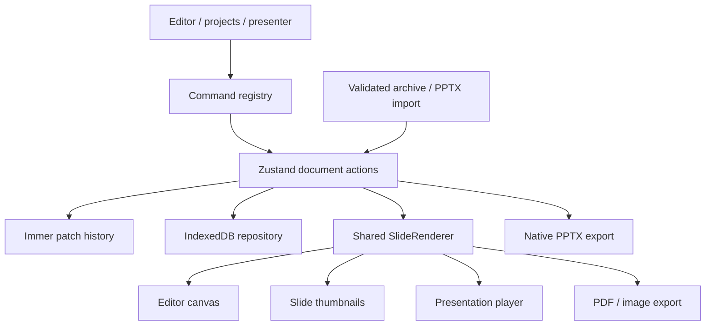

# Folio — Presentation Studio

A browser-based presentation workspace built with React 19, Vite 8, strict TypeScript, Tailwind CSS v4, and CLI-generated shadcn/Base UI components. The root opens a six-slide editorial strategy presentation; use the coral presentation icon to open your project library.

## Run

Node.js 22+ and pnpm are recommended.

```sh
pnpm install
pnpm dev
pnpm typecheck
pnpm lint
pnpm test
pnpm build
pnpm exec playwright install chromium
pnpm e2e
```

## Workspace

- Three resizable columns: sortable slide thumbnails, logical DOM/SVG canvas, and contextual inspector.
- Eight layouts and six presentation themes. Solid, gradient, and image backgrounds; editable transitions, speaker notes, and skipped slides.
- Text, 25 SVG shape kinds, straight/elbow/curved lines, images, tables, and seven chart types.
- Double-click text or table cells for TipTap editing. The inspector edits geometry, fill, outlines, shadows, image filters/crops, chart data, links, and animation settings.
- Pointer-based move, rotation, eight resize handles, shift-selection, marquee selection, grouping, snap guides, keyboard nudging, pan, fit, and zoom.
- Layers support naming, visibility, locking, selection, and z-order controls.
- Document actions use Immer patches. Undo/redo stores up to 200 entries and restores selection; pointer interactions commit a single document edit.
- IndexedDB autosave with a one-second debounce, serialized writes, startup restoration, and explicit save. Browser-local projects require no account or backend.
- Project archive, PowerPoint, PDF, and PNG exports. Project archive and basic PowerPoint import from the project library.
- Fullscreen presentation playback, animation builds, transitions, slide overview, black/white screen, SVG ink and laser, and a synchronized presenter window.
- System-aware dark theme with a persistent manual override.

## Architecture



Domain definitions are in `src/types/model.ts`. Elements are a discriminated union on `type`; coordinates use a 1920 × 1080 logical slide space. Elements are a flat z-ordered array; `groupId` associates group members. Rich text is recursive typed TipTap JSON. Image `assetId` accepts an embedded data URL, remote URL, or repository asset key. Notes are consistently plain text.

Rendering is shared in `src/features/renderer`. Pure geometry and unit conversion are in `src/lib`. Pointer geometry stays transient until commit. The command registry drives editor menus, the command palette, and generated shortcut help. Generated shadcn components are isolated in `src/components/ui`.

## Keyboard

Windows/Linux use Ctrl; macOS uses Command. Shortcuts are scoped away from editable inputs.

| Action | Shortcut |
|---|---|
| Undo / redo | Ctrl+Z / Ctrl+Shift+Z |
| Copy / cut / paste | Ctrl+C / Ctrl+X / Ctrl+V |
| Duplicate / delete | Ctrl+D / Delete |
| Select all | Ctrl+A |
| New slide | Ctrl+M |
| Group / ungroup | Ctrl+G / Ctrl+Shift+G |
| Lock / unlock | Ctrl+L |
| Forward / backward | Ctrl+] / Ctrl+[ |
| Front / back | Ctrl+Shift+] / Ctrl+Shift+[ |
| Text / rectangle / ellipse / line | T / R / O / L |
| Zoom in / out / fit | Ctrl+= / Ctrl+- / Ctrl+0 |
| Nudge / large nudge | Arrows / Shift+Arrows |
| Present start / current | F5 / Shift+F5 |
| Command palette / shortcut help | Ctrl+K / ? |
| Save | Ctrl+S |
| Deselect / exit presenter | Esc |

## Adding an element type

1. Add an interface extending `ElementBase` and a unique `type` discriminator in `src/types/model.ts`; include it in `SlideElement`.
2. Extend the runtime schema in `src/features/export/schema.ts`.
3. Add typed initial data in `createElement` in `src/lib/defaults.ts`.
4. Add the renderer branch in `SlideRenderer` and ensure the exhaustive `never` check passes.
5. Add controls in the contextual properties panel and an insertion entry in the toolbar/command registry.
6. Map the element to native PowerPoint in `src/features/export/pptx.ts`; project archives retain all validated domain fields automatically.
7. Update theme recoloring and asset reference traversal if the type owns colors or images.
8. Add behavioral unit coverage and exercise insertion, editing, undo, persistence, presentation, and export in a real browser.

## Export limitations

`.pptjson` is a ZIP containing `presentation.json`, an asset manifest, and embedded images. It preserves the editable document. Assets are embedded during export and restored as data URLs on import; image source strings may change although rendered content is preserved. Files and expanded assets are limited to 100 MB. Remote images require CORS; missing assets stop export explicitly.

PPTX uses native editable text, shapes, lines, images, tables, and charts, and includes notes and supported links. Native PowerPoint output is not pixel-identical: gradient fills use their first stop; image effects/crops/clipping, curved connectors, some rich-text styles, transitions, and animations are approximated or omitted. Fonts must exist on the destination computer.

Basic PPTX import handles positioned text, common shapes, connectors, images, tables, cached chart data, backgrounds, and notes. It does not reconstruct master/layout inheritance, grouped objects, advanced geometry, media/OLE, detailed theme/rich-text metadata, or animations.

PDF and PNG use the shared renderer and rasterize slides. All slides, including skipped ones, are exported. Notes and playback builds are not included. Font and remote-image availability affect export.

## Browser behavior and current boundaries

Fullscreen, clipboard, and presenter pop-ups require browser permission and a secure origin (localhost is supported). Presenter sync uses same-origin `BroadcastChannel`; static presenter previews show complete slides rather than the current animation build. Ink is temporary and clears on slide changes. Projects live in this browser profile; deleting site data deletes local projects.

The current implementation does not provide complete PowerPoint feature parity. Advanced table span/drag editing, format painter, token-valued color storage, equal-spacing guides, virtualized thumbnail rendering, printable notes-page PDF, JPEG/scale export options, and storage reference-count garbage collection are not yet represented as complete workflows. Browser performance and full accessibility conformance have not been benchmarked or certified. The strings module establishes a shared copy surface but not all labels have been migrated.
