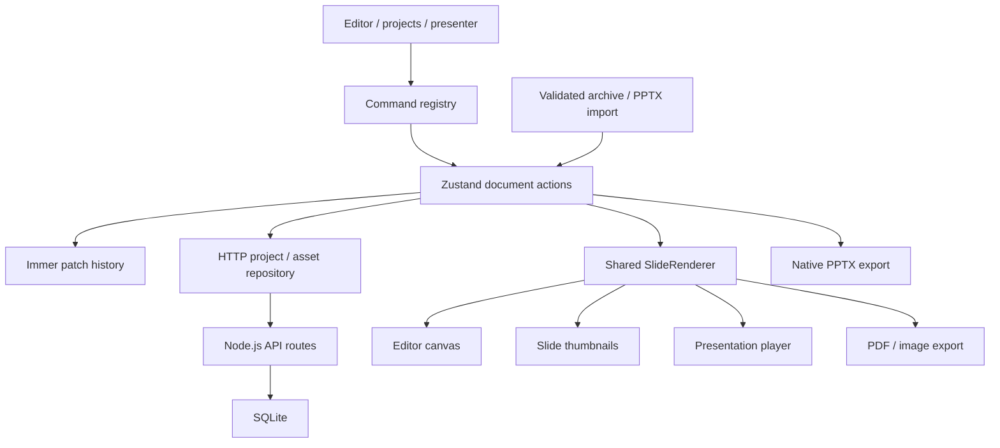

# Folio — Presentation Studio

A presentation workspace built with React 19, Vite 8, strict TypeScript, Tailwind CSS v4, CLI-generated shadcn/Base UI components, and a dependency-free Node.js TypeScript API with SQLite persistence. The root opens a six-slide editorial strategy presentation; use the coral presentation icon to open your project library.

## Repository layout

- `frontend/` — React/Vite application: `src/`, `public/`, frontend configuration, package manifest/lockfiles, and unit/browser tests. Production output is `frontend/dist/`.
- `backend/node/` — Node.js HTTP API in TypeScript (`node:http` + built-in `node:sqlite`), run directly with Node's type stripping; no build step and no runtime dependencies. This is the API used for local development.
- `backend/Folio.Api/` — the original ASP.NET Core 10 API, kept as the reference implementation. CI verifies both backends expose identical endpoints (see [Backend contract](#backend-contract)).
- `backend/contract/` — cross-backend contract check (`compare.ts`).
- `.githooks/`, `scripts/check-commit-scope.sh` — the commit scope rule (see [Commit rules](#commit-rules)).
- `apphost/` — Aspire **TypeScript** AppHost (`apphost.mts`, run by Node via `tsx`; no compiled .NET executable).
- Root `aspire.config.json` — selects the AppHost for `aspire run`.
- Root `package.json` / `scripts/dev.mjs` — convenience scripts that install, run and verify the packages without Aspire.
- Root `.cache/` — ignored, isolated test/smoke databases.

## Run

Requires **Node.js 22.13+** (for unflagged `node:sqlite` and `--experimental-strip-types`). No .NET SDK or Docker is needed; the Aspire CLI is optional.

### With Aspire

```sh
npm --prefix apphost ci   # once
aspire run
```

Open the dashboard login URL printed by Aspire, then the `frontend` resource's URL. Aspire runs `npm ci` in `backend/node/` and `frontend/`, starts the API on an assigned port (injected as `FOLIO_API_PORT`), waits for `/api/health`, and launches Vite with `FOLIO_API_URL` pointing at the API. For an isolated database: `FOLIO_DATABASE_PATH=/abs/path/folio.db aspire run`. The SDK code under `apphost/.aspire/` is generated by `aspire run`/`aspire restore` and is git-ignored.

### Without Aspire

From the repository root:

```sh
npm run setup   # enables git hooks; npm ci in backend/node/, frontend/ and apphost/
npm run dev     # API on http://localhost:5080 (auto-restarts on change) + Vite on http://localhost:5173
```

Open `http://localhost:5173`. Vite proxies `/api` to the API, so requests stay same-origin. Ctrl+C stops both processes.

To run them separately:

```sh
# Terminal 1 — http://localhost:5080
npm --prefix backend/node run dev

# Terminal 2 — http://localhost:5173
npm --prefix frontend run dev
```

For an isolated database, set `FOLIO_DATABASE_PATH` (relative paths resolve against `backend/node/`):

```sh
FOLIO_DATABASE_PATH=/path/to/folio.db npm run dev
```

Verification and production builds, from the repository root:

```sh
npm --prefix apphost run typecheck
npm --prefix backend/node run typecheck
npm --prefix backend/node test
npm run contract   # route inventory: Node vs .NET
npm --prefix frontend run typecheck
npm --prefix frontend run lint
npm --prefix frontend test
npm --prefix frontend run build
npm --prefix frontend exec -- playwright install chromium
npm --prefix frontend run e2e
```

Run shadcn tooling in `frontend/` so it resolves `components.json`, TypeScript aliases and `src/index.css` correctly.

Vite dev and preview proxy `/api` to `http://localhost:5080`; set `FOLIO_API_URL` in the frontend process environment to change that URL. The API does not serve the frontend build or enable cross-origin access.

**Scope:** Aspire and the dev script orchestrate local development, not production hosting. In production, serve `frontend/dist/` and reverse-proxy `/api` to the API (`npm --prefix backend/node start`) on the same origin. A deployment target and production static-file/proxy configuration are not configured here; the Vite dev proxy does not replace them.

## Backend

`backend/node/src/server.ts` starts the API; `app.ts` routes requests, `repository.ts` owns SQLite persistence, `projectDocument.ts` validates presentation envelopes, `fonts.ts` validates font uploads, and `users.ts` supplies the current user. TypeScript uses only erasable syntax so Node runs the sources directly; `tsc` is used for type checking only. Backend tests use `node:test` against a real HTTP server and an in-memory database.

| Variable | Default | Purpose |
|---|---|---|
| `FOLIO_API_HOST` | `localhost` | Listen address; `localhost` binds both `127.0.0.1` and `::1` |
| `FOLIO_API_PORT` | `5080` | Listen port |
| `FOLIO_DATABASE_PATH` | `App_Data/folio.db` | SQLite file, relative to `backend/node/`; `:memory:` for a throwaway database |
| `FOLIO_ALLOWED_HOSTS` | `localhost;127.0.0.1;[::1]` | Accepted `Host` header names; `*` accepts any |

### Backend contract

`backend/Folio.Api/` (ASP.NET Core, `dotnet run --project backend/Folio.Api`) and `backend/node/` must stay interchangeable. The [Backend contract workflow](.github/workflows/backend-contract.yml) runs on every pull request touching `backend/**`:

1. **Route inventory** — method/path pairs parsed from the C# controller attributes must equal the Node route table (`listRoutes` in `app.ts`). Run locally with `npm run contract`.
2. **Behavior** — both servers start with fresh databases and [`compare.ts`](backend/contract/compare.ts) sends the same ~70-request scenario to each (CRUD, ordering, encoded IDs, validation failures, conflicts, assets, collection, font uploads and content, 404/405/415, Host filtering). Status codes, media types, `Content-Disposition`/`X-Content-Type-Options` and bodies must match; problem responses compare by status because framework-generated titles differ, and IDs each server generates (font IDs) compare as present strings.

When you add or change an endpoint, change both backends and extend the scenario. Building the .NET API locally may be blocked by binary-authorization tools; CI runners are unaffected.

| Method | Route | Behavior |
|---|---|---|
| GET | `/api/health` | Process health (`{"status":"ok"}`) |
| GET | `/api/users/me` | Current user identity (`id`, `displayName`, `initials`) for both avatars |
| GET | `/api/projects` | Summaries, newest update first |
| GET | `/api/projects/latest/document` | Most recently updated full presentation, or 404 |
| GET | `/api/projects/{id}` | Full presentation, or 404 |
| PUT | `/api/projects/{id}` | Create or replace a full presentation; 204 on success |
| DELETE | `/api/projects/{id}` | Idempotent deletion; 204, with exclusive asset collection |
| PUT | `/api/assets/{id}` | Store raw bytes with the request's Content-Type; 204 |
| GET | `/api/assets/{id}` | Raw bytes and stored Content-Type, or 404 |
| GET | `/api/fonts` | Uploaded font IDs and family names |
| POST / PUT | `/api/fonts?family={name}` | Store validated TTF/OTF/WOFF/WOFF2 bytes, up to 20 MiB; duplicate family returns 409 |
| GET | `/api/fonts/{id}/content` | Uploaded font bytes for browser registration |

URL-encode resource IDs. The latest-document route has two segments so a project named `latest` remains retrievable. Project PUT preserves the presentation JSON, checks the version-1 envelope, timestamps, positive slide dimensions, slide/element containers and asset references, and rejects malformed JSON or a route/body ID mismatch with 400. The editor's existing Zod schema remains the full import validation boundary. Both PUT routes accept `If-None-Match: *` for create-only migration and return 412 if the resource already exists. Requests are limited to 100 MiB. Errors use HTTP status codes and `application/problem+json` bodies.

The database defaults to `backend/node/App_Data/folio.db`; override it with `FOLIO_DATABASE_PATH`. The schema is shared with the ASP.NET API, so an existing `folio.db` can be reused by pointing `FOLIO_DATABASE_PATH` at it. Back up the database using SQLite-aware tooling, or stop the API before copying the database and any WAL files. Project writes and asset ownership changes are transactional. Deleting a project preserves shared assets and pending uploads; assets removed from a document during editing are not automatically collected.

The editor and project library display the backend identity from `/api/users/me`. The `CurrentUserProvider` passed to `createApp` currently returns one hardcoded local user, Jordan Doe (`JD`, ID `local-jordan-doe`), without authentication or a user database. Pass a different provider to integrate an external identity system without changing the frontend contract. Avatars are informational, not account-menu buttons; loading and failed requests do not fabricate an identity.

On first project access, the frontend imports existing `chapter-editor` IndexedDB projects and their referenced stored blobs. Create-only writes never replace existing server projects or assets. Migration is marked complete only after every upload succeeds; failures remain retryable on the next access. Browser originals are retained for recovery, not used as an offline fallback. Settings, theme preferences and panel sizes remain browser-local. All browser profiles connected to the same API now share the same project library.

**Deployment boundary:** no authentication, authorization, user isolation or collaboration conflict resolution. The default API listener is loopback-only. Keep it local or behind trusted access control; do not expose it as a public multi-user service. Saves replace whole documents, so concurrent editors use last-write-wins behavior. The backend must be running for project persistence.

## Workspace

- Three resizable columns: sortable slide thumbnails, logical DOM/SVG canvas, and contextual inspector. Slide reordering is constrained to up/down movement so sideways dragging cannot expand the slide list.
- The canvas extends directly to speaker notes without a separate instruction/hint bar.
- Rename the presentation directly in the header title field; use the presentation icon to return to the project library. Present starts playback directly without a dropdown menu.
- Eight layouts and six presentation themes. Solid, gradient, and image backgrounds; editable transitions, speaker notes, and skipped slides.
- Text, 25 SVG shape kinds, straight/elbow/curved lines, images, tables, and seven chart types.
- Double-click text or table cells for TipTap editing. The inspector edits geometry, fill, outlines, shadows, image filters/crops, chart data, links, and animation settings.
- Image masks distinguish square corners (`none`), the configured corner radius (`roundRect`), and an ellipse; switching masks preserves the configured radius.
- Shape image fills expose Cover and Contain only. Tile remains available for supported slide-background and text fills; older tiled shape fills retain their existing Cover-style rendering.
- Chart controls disable unsupported options: Values for scatter, Grid for pie/donut, and Stacked except for bar, horizontal bar, and area. Switching types preserves the saved option values.
- Flip commands enable only when the selection includes an unlocked shape or image; mixed selections flip only those supported elements. Arrange availability refreshes immediately when selection changes.
- Project-library Import is a keyboard-focusable button; Enter or Space opens the same file picker used by mouse activation.
- Text sizing is manual in the editor; the nonfunctional Auto fit selector is not exposed. Existing auto-fit document values are retained for import/export compatibility and PowerPoint export.
- Pointer-based move, rotation, eight resize handles, shift-selection, marquee selection, grouping, snap guides, keyboard nudging, pan, fit, and zoom.
- Layers support naming, visibility, locking, selection, and z-order controls. Locked layers can be unlocked from Design → Layers; other element edits remain blocked until unlocking.
- Document actions use Immer patches. Undo/redo stores up to 200 entries and restores selection; pointer interactions commit a single document edit.
- API-backed SQLite autosave with serialized, debounced writes, startup restoration, and explicit save. Backend failures show failed-save status rather than falling back to local projects.
- Project archive, PowerPoint, PDF, and PNG exports. Project archive and basic PowerPoint import from the project library.
- Fullscreen presentation playback, animation builds, transitions, slide overview, black/white screen, SVG ink and laser, and a synchronized presenter window.
- System-aware dark theme with a persistent manual override that applies to every page, and a uniform full-width editing toolbar background.

## Interface theme

The interface reads only the standard shadcn/ui CSS variables (`--background`, `--primary`, `--muted`, `--sidebar-*`, `--radius`, `--font-sans`, `--shadow-*`, `--tracking-normal`, …) from the `:root` and `.dark` blocks of `frontend/src/index.css`: the same set [tweakcn](https://tweakcn.com) exports. To apply a tweakcn theme, run this in `frontend/`:

```sh
npx shadcn@latest add https://tweakcn.com/r/themes/<theme>.json
```

or paste the `:root` and `.dark` blocks from tweakcn's code panel over the existing ones. Load any web font the theme names in `--font-sans` (for example with an `@fontsource` package); keep `'Folio Arabic'` in that list to keep the bundled Arabic font for Arabic interface text.

The light/dark choice (moon/sun button in the editor) applies to every page and is stored as `folio-theme`; until you choose, the system preference is used. The slideshow stage always uses the theme's dark variables. Slide artwork, template and theme previews, presentation color swatches, the laser pointer and black/white audience screens keep their presentation colors.

## Language and Arabic editing

Open **Settings** (the gear icon in the editor or project library), then select **English** or **العربية**. The interface switches immediately and remembers the choice in browser-local `folio-locale` storage. Arabic uses an RTL interface; presentation artwork, coordinates, numeric dimensions, and existing document content are not mirrored or translated.

Text boxes, shape/table text, titles, and speaker notes accept Arabic and mixed Arabic/English content. Paragraph direction follows the first strong character independently of interface language. A bundled, SIL-OFL-licensed Amiri font provides Arabic glyphs without an external font request.

## Font library

In **Settings → Font library**, enter the exact font-family name and upload a TTF, OTF, WOFF, or WOFF2 file (maximum 20 MiB). The browser validates and registers the file, and the backend stores its metadata and bytes separately from project assets. Uploaded families appear in font selectors and reload on later visits; all clients connected to the same backend share this library. Upload only fonts you are licensed to use and share.

Opening a presentation waits for registered fonts. If a referenced family is unavailable, a blocking dialog lets you upload that exact family or explicitly choose a replacement for every missing family. Replacements update theme, text, and rich-text font references without changing content or coordinates; returning to the library leaves the presentation unchanged. PPTX import retains theme, complex-script, and per-run fonts so missing families can be detected. This applies to supported `.pptx` imports; legacy binary `.ppt` conversion is not supported.

PDF speaker notes embed the bundled Arabic font and use Unicode bidirectional ordering. PPTX preserves logical Arabic text and paragraph RTL metadata; uploaded font binaries are not embedded in PPTX, so recipients still need the fonts installed.

## Architecture



Domain definitions are in `frontend/src/types/model.ts`. Elements are a discriminated union on `type`; coordinates use a 1920 × 1080 logical slide space by default, with custom dimensions shared by editor, player, and raster export. Elements are a flat z-ordered array; `groupId` associates group members. Rich text is recursive typed TipTap JSON. Image `assetId` accepts an embedded data URL, remote URL, or repository asset key. Notes accept legacy plain text and sanitized basic HTML produced by TipTap; export converts them to plain text.

Rendering is shared in `frontend/src/features/renderer`. Pure geometry and unit conversion are in `frontend/src/lib`. Pointer geometry stays transient until commit. The command registry drives editor menus, the command palette, and generated shortcut help. Generated shadcn components are isolated in `frontend/src/components/ui`.

In **Design → Layers**, drag the grip on the right of a row to change stacking order; the first row is the frontmost element. Each completed drag creates one undo entry. For keyboard reordering, focus the grip, press Space to pick up, use Up/Down arrows, and press Space to drop or Escape to cancel.

## Runtime strings

`frontend/src/strings.ts` exports the single `strings` const object. Its values live in small `frontend/src/constants/strings/` modules grouped by feature; `strings.common` owns values shared across features. All application runtime string literals use this object, including UI/accessibility copy, errors, history labels, default slide content, discriminants, CSS classes, colors, routes, storage keys, and interpolated template fragments.

Display translation is separate from these immutable runtime tokens: call the reactive `useTranslation()` hook from `features/localization/locale.ts` at UI boundaries, and add Arabic display copy to `features/localization/ar.ts`. Keep model/option values, commands, routes, classes, and user-authored content unchanged. Shared choice controls translate labels, never stored values.

```tsx
import { strings } from '@/strings';

<Input aria-label={strings.common.presentationTitle} />
```

Add new values to the relevant constants module and consume them through `strings`. Values use `as const` to retain their literal types. Mutable string state and string-default parameters are explicitly typed; `frontend/src/lib/typeGuards.ts` preserves TypeScript narrowing for runtime `typeof` checks.

Import/export module specifiers (including dynamic imports), TypeScript type literals, and required directives such as `"use client"` remain syntactic literals. CSS, HTML, SVG, configuration files, and test fixtures are outside the application runtime-string migration. Empty template segments and formatting-only JSX whitespace carry no hardcoded string value.

## Keyboard

Windows/Linux use Ctrl; macOS uses Command. Shortcuts are scoped away from editable inputs.

| Action | Shortcut |
|---|---|
| Undo / redo | Ctrl+Z / Ctrl+Shift+Z |
| Copy / cut / paste | Ctrl+C / Ctrl+X / Ctrl+V |
| Duplicate / delete | Ctrl+D / Delete |
| Select all | Ctrl+A |
| New slide | Ctrl+M |
| Group / ungroup | Ctrl+G / Ctrl+Shift+G |
| Lock / unlock | Ctrl+L |
| Forward / backward | Ctrl+] / Ctrl+[ |
| Front / back | Ctrl+Shift+] / Ctrl+Shift+[ |
| Text / rectangle / ellipse / line | T / R / O / L |
| Zoom in / out / fit | Ctrl+= / Ctrl+- / Ctrl+0 |
| Nudge / large nudge | Arrows / Shift+Arrows |
| Present start / current | F5 / Shift+F5 |
| Command palette / shortcut help | Ctrl+K / ? |
| Save | Ctrl+S |
| Deselect / exit presenter | Esc |

## Adding an element type

1. Add an interface extending `ElementBase` and a unique `type` discriminator in `frontend/src/types/model.ts`; include it in `SlideElement`.
2. Extend the runtime schema in `frontend/src/features/export/schema.ts`.
3. Add typed initial data in `createElement` in `frontend/src/lib/defaults.ts`.
4. Add the renderer branch in `SlideRenderer` and ensure the exhaustive `never` check passes.
5. Add controls in the contextual properties panel and an insertion entry in the toolbar/command registry.
6. Map the element to native PowerPoint in `frontend/src/features/export/pptx.ts`; project archives retain all validated domain fields automatically.
7. Update theme recoloring and asset reference traversal if the type owns colors or images.
8. Add behavioral unit coverage and exercise insertion, editing, undo, persistence, presentation, and export in a real browser.

## Export limitations

`.pptjson` is a ZIP containing `presentation.json`, an asset manifest, and embedded images. It preserves the editable document. Assets are embedded during export and restored as data URLs on import; image source strings may change although rendered content is preserved. Files and expanded assets are limited to 100 MB. Remote images require CORS; missing assets stop export explicitly.

PPTX uses native editable text, shapes, lines, images, tables, and charts, and includes notes and supported links. Native PowerPoint output is not pixel-identical: gradient fills use their first stop; image effects/crops/clipping, curved connectors, some rich-text styles, transitions, and animations are approximated or omitted. Fonts must exist on the destination computer.

Basic PPTX import handles positioned text, common shapes, connectors, images, tables, cached chart data, backgrounds, and notes. It does not reconstruct master/layout inheritance, grouped objects, advanced geometry, media/OLE, detailed theme/rich-text metadata, or animations.

PDF and PNG/JPEG use the shared renderer and rasterize slides. PDF optionally includes printable, paginated notes pages. Image export supports the current slide or all slides and 1×–4× resolution. Skipped slides are included in all-slide exports; playback builds are not. Font and remote-image availability affect export.

Raster exports reset off-screen staging to static positioning in the captured clone, preventing blank PDF/image output. Referenced images are embedded as data URLs before capture using the shared asset loader; remote images still require CORS. The browser regression verifies actual background/artwork pixels, and PDF smoke verification renders the generated slide-only and speaker-notes documents.

## Browser behavior and current boundaries

Fullscreen, clipboard, and presenter pop-ups require browser permission and a secure origin (localhost is supported). Presenter sync uses same-origin `BroadcastChannel`; static presenter previews show complete slides rather than the current animation build. Ink is temporary and clears on slide changes. Projects and stored assets live in the API database; clearing browser site data deletes local preferences and retained migration originals, not server projects.

The current implementation does not provide complete PowerPoint feature parity. Table merge/split and row/column sizing are available in the spreadsheet dialog, but direct row/column dragging is not. Format painter, token-valued color storage, equal-spacing guides, full rich-text control coverage, image crop-handle mode, animation drag-order UI, and complete shortcut parity remain incomplete. Thumbnail artwork is viewport-virtualized and debounced. Project deletion safely garbage-collects unshared referenced assets; save-time asset garbage collection is not implemented. Browser performance has not been benchmarked against the 100-element/60-fps target. Accessibility lint passes, but full accessibility conformance has not been certified.

## Commit rules

A commit may not change both `frontend/` and `backend/`; everything else (`apphost/`, docs, root config, CI) can go with either side. `npm run setup` (or `npm run hooks`) sets `core.hooksPath` to `.githooks/`, whose `pre-commit` hook runs `scripts/check-commit-scope.sh --staged`. The [Commit scope workflow](.github/workflows/commit-scope.yml) checks every non-merge commit of a pull request (and pushes to `main`), so commits made with `--no-verify` are still caught.

## Verification

The Node backend passes `tsc` type checking and `node:test` HTTP integration tests covering health, current user, project CRUD and timestamp ordering, encoded IDs (including `/` and a project named `latest`), validation failures, unsupported media types, create-only conflicts, binary asset round trips with download-safe headers, exclusive asset collection on delete, font uploads (TTF/OTF/WOFF/WOFF2 detection, family-name rules, case-insensitive duplicates, the 20 MiB limit) with listing and content, unknown routes, 405 responses, and Host filtering. Playwright starts its own API on port 5081 with an isolated database under `.cache/playwright/` and Vite on port 5174, with serialized project resets so tests never clear the normal workspace.
