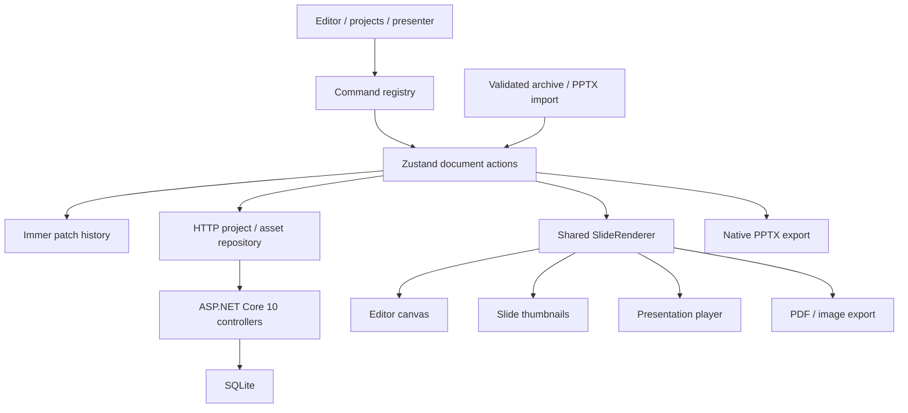

# Folio — Presentation Studio

A presentation workspace built with React 19, Vite 8, strict TypeScript, Tailwind CSS v4, CLI-generated shadcn/Base UI components, and an ASP.NET Core 10 controller-based backend with SQLite persistence. The root opens a six-slide editorial strategy presentation; use the coral presentation icon to open your project library.

## Repository layout

- `frontend/` — React/Vite application: `src/`, `public/`, frontend configuration, package manifest/lockfiles, and unit/browser tests. Production output is `frontend/dist/`.
- `backend/Folio.Api/` — ASP.NET Core 10 controller API and SQLite persistence.
- `apphost/` — .NET 10 C# Aspire AppHost, pinned to Aspire 13.3.5.
- Root `aspire.config.json` — selects the AppHost for `aspire run`; there is no root Node package.
- Root `.cache/` — ignored, isolated test/smoke databases.

## Run

Requires Node.js 22+, the **.NET 10 SDK**, and the **Aspire CLI**. The AppHost uses Aspire 13.3.5, matching the installed CLI. Docker is not required: the API and Vite run as local processes, and SQLite remains file-backed.

On a new machine, install the CLI and trust the HTTPS development certificate once:

```sh
dotnet tool install --global Aspire.Cli --version 13.3.5
dotnet dev-certs https --trust
```

From the repository root:

```sh
aspire run
```

Open the dashboard login URL printed by Aspire, then open the `frontend` resource's URL. Aspire runs `npm ci` in `frontend/`, starts the API, waits for `/api/health`, and launches Vite on an assigned port. It injects the API endpoint as `FOLIO_API_URL`, so `/api` requests stay same-origin through Vite's proxy without hard-coded Aspire ports. The dashboard uses HTTPS and token authentication; Ctrl+C stops the orchestrated processes.

For an isolated database, pass an absolute path to the AppHost:

```sh
aspire run -- --Database:Path=C:/path/to/folio.db
```

The AppHost forwards this override to the API. Relative AppHost overrides resolve against `apphost/`; without an override, the API keeps its normal persistent `App_Data/folio.db`.

To run without Aspire, install frontend dependencies with `npm --prefix frontend ci` (or `pnpm --dir frontend install --frozen-lockfile`), then use separate terminals:

```sh
# Terminal 1 — http://localhost:5080
dotnet run --project backend/Folio.Api

# Terminal 2 — http://localhost:5173
npm --prefix frontend run dev
```

Verification and production builds, from the repository root:

```sh
dotnet build apphost/Folio.AppHost.csproj
npm --prefix frontend run typecheck
npm --prefix frontend run lint
npm --prefix frontend test
npm --prefix frontend run build
npm --prefix frontend exec -- playwright install chromium
npm --prefix frontend run e2e
```

All Node commands belong to `frontend/`; alternatively, run `npm run dev`, `npm run build`, `npm test`, etc. from that folder. Run shadcn tooling there so it resolves `components.json`, TypeScript aliases and `src/index.css` correctly.

Without Aspire, Vite dev and preview proxy `/api` to `http://localhost:5080`; set `FOLIO_API_URL` in the frontend process environment to change that URL. The API does not serve the frontend build or enable cross-origin access.

**Aspire scope:** this AppHost orchestrates local development, not production hosting. In production, serve `frontend/dist/` and reverse-proxy `/api` to the API on the same origin. A deployment target and production static-file/proxy configuration are not configured here; the Vite dev proxy does not replace them. See the official [JavaScript/Vite integration](https://aspire.dev/integrations/frameworks/javascript/), [.NET project integration](https://aspire.dev/integrations/dotnet/project-resources/), and [JavaScript deployment guidance](https://aspire.dev/deployment/javascript-apps/).

## Backend

`backend/Folio.Api/Folio.Api.csproj` targets `net10.0`. `Program.cs` registers controllers with `AddControllers()` and `MapControllers()`. `ProjectsController`, `AssetsController`, and `HealthController` use a dependency-injected SQLite repository; these are MVC controller endpoints, not minimal API handlers. Standalone development exposes OpenAPI at `http://localhost:5080/openapi/v1.json`; under Aspire, use the dashboard's API resource URL with `/openapi/v1.json`.

| Method | Route | Behavior |
|---|---|---|
| GET | `/api/health` | Process health (`{"status":"ok"}`) |
| GET | `/api/projects` | Summaries, newest update first |
| GET | `/api/projects/latest/document` | Most recently updated full presentation, or 404 |
| GET | `/api/projects/{id}` | Full presentation, or 404 |
| PUT | `/api/projects/{id}` | Create or replace a full presentation; 204 on success |
| DELETE | `/api/projects/{id}` | Idempotent deletion; 204, with exclusive asset collection |
| PUT | `/api/assets/{id}` | Store raw bytes with the request's Content-Type; 204 |
| GET | `/api/assets/{id}` | Raw bytes and stored Content-Type, or 404 |

URL-encode resource IDs. The latest-document route has two segments so a project named `latest` remains retrievable. Project PUT preserves the presentation JSON, checks the version-1 envelope, timestamps, positive slide dimensions, slide/element containers and asset references, and rejects malformed JSON or a route/body ID mismatch with 400. The editor's existing Zod schema remains the full import validation boundary. Both PUT routes accept `If-None-Match: *` for create-only migration and return 412 if the resource already exists. Requests are limited to 100 MiB. Errors use HTTP status codes and ProblemDetails.

The database defaults to `backend/Folio.Api/App_Data/folio.db`. Override `Database:Path` in configuration or set `Database__Path` in the API process environment; relative paths resolve against the API content root. Back up the database using SQLite-aware tooling, or stop the API before copying the database and any WAL files. Project writes and asset ownership changes are transactional. Deleting a project preserves shared assets and pending uploads; assets removed from a document during editing are not automatically collected.

On first project access, the frontend imports existing `chapter-editor` IndexedDB projects and their referenced stored blobs. Create-only writes never replace existing server projects or assets. Migration is marked complete only after every upload succeeds; failures remain retryable on the next access. Browser originals are retained for recovery, not used as an offline fallback. Settings, theme preferences and panel sizes remain browser-local. All browser profiles connected to the same API now share the same project library.

**Deployment boundary:** no authentication, authorization, user isolation or collaboration conflict resolution. The default API listener is loopback-only. Keep it local or behind trusted access control; do not expose it as a public multi-user service. Saves replace whole documents, so concurrent editors use last-write-wins behavior. The backend must be running for project persistence.

## Workspace

- Three resizable columns: sortable slide thumbnails, logical DOM/SVG canvas, and contextual inspector. Slide reordering is constrained to up/down movement so sideways dragging cannot expand the slide list.
- Rename the presentation directly in the header title field; use the presentation icon to return to the project library.
- Eight layouts and six presentation themes. Solid, gradient, and image backgrounds; editable transitions, speaker notes, and skipped slides.
- Text, 25 SVG shape kinds, straight/elbow/curved lines, images, tables, and seven chart types.
- Double-click text or table cells for TipTap editing. The inspector edits geometry, fill, outlines, shadows, image filters/crops, chart data, links, and animation settings.
- Pointer-based move, rotation, eight resize handles, shift-selection, marquee selection, grouping, snap guides, keyboard nudging, pan, fit, and zoom.
- Layers support naming, visibility, locking, selection, and z-order controls.
- Document actions use Immer patches. Undo/redo stores up to 200 entries and restores selection; pointer interactions commit a single document edit.
- API-backed SQLite autosave with serialized, debounced writes, startup restoration, and explicit save. Backend failures show failed-save status rather than falling back to local projects.
- Project archive, PowerPoint, PDF, and PNG exports. Project archive and basic PowerPoint import from the project library.
- Fullscreen presentation playback, animation builds, transitions, slide overview, black/white screen, SVG ink and laser, and a synchronized presenter window.
- System-aware dark theme with a persistent manual override and a uniform full-width editing toolbar background.

## Architecture



Domain definitions are in `frontend/src/types/model.ts`. Elements are a discriminated union on `type`; coordinates use a 1920 × 1080 logical slide space by default, with custom dimensions shared by editor, player, and raster export. Elements are a flat z-ordered array; `groupId` associates group members. Rich text is recursive typed TipTap JSON. Image `assetId` accepts an embedded data URL, remote URL, or repository asset key. Notes accept legacy plain text and sanitized basic HTML produced by TipTap; export converts them to plain text.

Rendering is shared in `frontend/src/features/renderer`. Pure geometry and unit conversion are in `frontend/src/lib`. Pointer geometry stays transient until commit. The command registry drives editor menus, the command palette, and generated shortcut help. Generated shadcn components are isolated in `frontend/src/components/ui`.

In **Design → Layers**, drag the grip on the right of a row to change stacking order; the first row is the frontmost element. Each completed drag creates one undo entry. For keyboard reordering, focus the grip, press Space to pick up, use Up/Down arrows, and press Space to drop or Escape to cancel.

## Runtime strings

`frontend/src/strings.ts` exports the single `strings` const object. Its values live in small `frontend/src/constants/strings/` modules grouped by feature; `strings.common` owns values shared across features. All application runtime string literals use this object, including UI/accessibility copy, errors, history labels, default slide content, discriminants, CSS classes, colors, routes, storage keys, and interpolated template fragments.

```tsx
import { strings } from '@/strings';

<Input aria-label={strings.common.presentationTitle} />
```

Add new values to the relevant constants module and consume them through `strings`. Values use `as const` to retain their literal types. Mutable string state and string-default parameters are explicitly typed; `frontend/src/lib/typeGuards.ts` preserves TypeScript narrowing for runtime `typeof` checks.

Import/export module specifiers (including dynamic imports), TypeScript type literals, and required directives such as `"use client"` remain syntactic literals. CSS, HTML, SVG, configuration files, and test fixtures are outside the application runtime-string migration. Empty template segments and formatting-only JSX whitespace carry no hardcoded string value.

## Keyboard

Windows/Linux use Ctrl; macOS uses Command. Shortcuts are scoped away from editable inputs.

| Action | Shortcut |
|---|---|
| Undo / redo | Ctrl+Z / Ctrl+Shift+Z |
| Copy / cut / paste | Ctrl+C / Ctrl+X / Ctrl+V |
| Duplicate / delete | Ctrl+D / Delete |
| Select all | Ctrl+A |
| New slide | Ctrl+M |
| Group / ungroup | Ctrl+G / Ctrl+Shift+G |
| Lock / unlock | Ctrl+L |
| Forward / backward | Ctrl+] / Ctrl+[ |
| Front / back | Ctrl+Shift+] / Ctrl+Shift+[ |
| Text / rectangle / ellipse / line | T / R / O / L |
| Zoom in / out / fit | Ctrl+= / Ctrl+- / Ctrl+0 |
| Nudge / large nudge | Arrows / Shift+Arrows |
| Present start / current | F5 / Shift+F5 |
| Command palette / shortcut help | Ctrl+K / ? |
| Save | Ctrl+S |
| Deselect / exit presenter | Esc |

## Adding an element type

1. Add an interface extending `ElementBase` and a unique `type` discriminator in `frontend/src/types/model.ts`; include it in `SlideElement`.
2. Extend the runtime schema in `frontend/src/features/export/schema.ts`.
3. Add typed initial data in `createElement` in `frontend/src/lib/defaults.ts`.
4. Add the renderer branch in `SlideRenderer` and ensure the exhaustive `never` check passes.
5. Add controls in the contextual properties panel and an insertion entry in the toolbar/command registry.
6. Map the element to native PowerPoint in `frontend/src/features/export/pptx.ts`; project archives retain all validated domain fields automatically.
7. Update theme recoloring and asset reference traversal if the type owns colors or images.
8. Add behavioral unit coverage and exercise insertion, editing, undo, persistence, presentation, and export in a real browser.

## Export limitations

`.pptjson` is a ZIP containing `presentation.json`, an asset manifest, and embedded images. It preserves the editable document. Assets are embedded during export and restored as data URLs on import; image source strings may change although rendered content is preserved. Files and expanded assets are limited to 100 MB. Remote images require CORS; missing assets stop export explicitly.

PPTX uses native editable text, shapes, lines, images, tables, and charts, and includes notes and supported links. Native PowerPoint output is not pixel-identical: gradient fills use their first stop; image effects/crops/clipping, curved connectors, some rich-text styles, transitions, and animations are approximated or omitted. Fonts must exist on the destination computer.

Basic PPTX import handles positioned text, common shapes, connectors, images, tables, cached chart data, backgrounds, and notes. It does not reconstruct master/layout inheritance, grouped objects, advanced geometry, media/OLE, detailed theme/rich-text metadata, or animations.

PDF and PNG/JPEG use the shared renderer and rasterize slides. PDF optionally includes printable, paginated notes pages. Image export supports the current slide or all slides and 1×–4× resolution. Skipped slides are included in all-slide exports; playback builds are not. Font and remote-image availability affect export.

## Browser behavior and current boundaries

Fullscreen, clipboard, and presenter pop-ups require browser permission and a secure origin (localhost is supported). Presenter sync uses same-origin `BroadcastChannel`; static presenter previews show complete slides rather than the current animation build. Ink is temporary and clears on slide changes. Projects and stored assets live in the API database; clearing browser site data deletes local preferences and retained migration originals, not server projects.

The current implementation does not provide complete PowerPoint feature parity. Table merge/split and row/column sizing are available in the spreadsheet dialog, but direct row/column dragging is not. Format painter, token-valued color storage, equal-spacing guides, full rich-text control coverage, image crop-handle mode, animation drag-order UI, and complete shortcut parity remain incomplete. Thumbnail artwork is viewport-virtualized and debounced. Project deletion safely garbage-collects unshared referenced assets; save-time asset garbage collection is not implemented. Browser performance has not been benchmarked against the 100-element/60-fps target. Accessibility lint passes, but full accessibility conformance has not been certified.

## Verification

Backend integration verification passes a warning-free .NET build, frontend typecheck, strict ESLint, all 48 Vitest tests, the frontend production build, and four isolated Playwright scenarios (editor, layer drag/keyboard, panel resizing). The editor scenario also passes with the final latest-document route. Real HTTP/browser smoke scenarios cover project CRUD and timestamp ordering, binary asset round trips, invalid/missing/conflicting requests, concurrent create-only writes, asset collection, 100 MiB request rejection, OpenAPI generation, persistence across API restart, UI save/reload, legacy IndexedDB migration without server overwrites, image loading and embedded image resolution, and visible failed saves during a real backend outage followed by successful explicit saving after recovery. Playwright owns a separate API/database on port 5081 and Vite on port 5174, with serialized project resets so tests never clear the normal workspace. The previously observed authoring/export-dialog timeout remains outside this backend change and was not rerun.

Aspire verification passes a warning-free AppHost/API build, frontend production build/typecheck, strict ESLint, and all 48 Vitest tests. Actual `aspire run --isolated` verifies the HTTPS dashboard, completed frontend dependency installation, healthy API, Vite startup with assigned ports, injected API endpoint, browser-to-controller proxying, and project save/reload restoration against an isolated SQLite database. The existing authoring/export timeout was not rerun.
